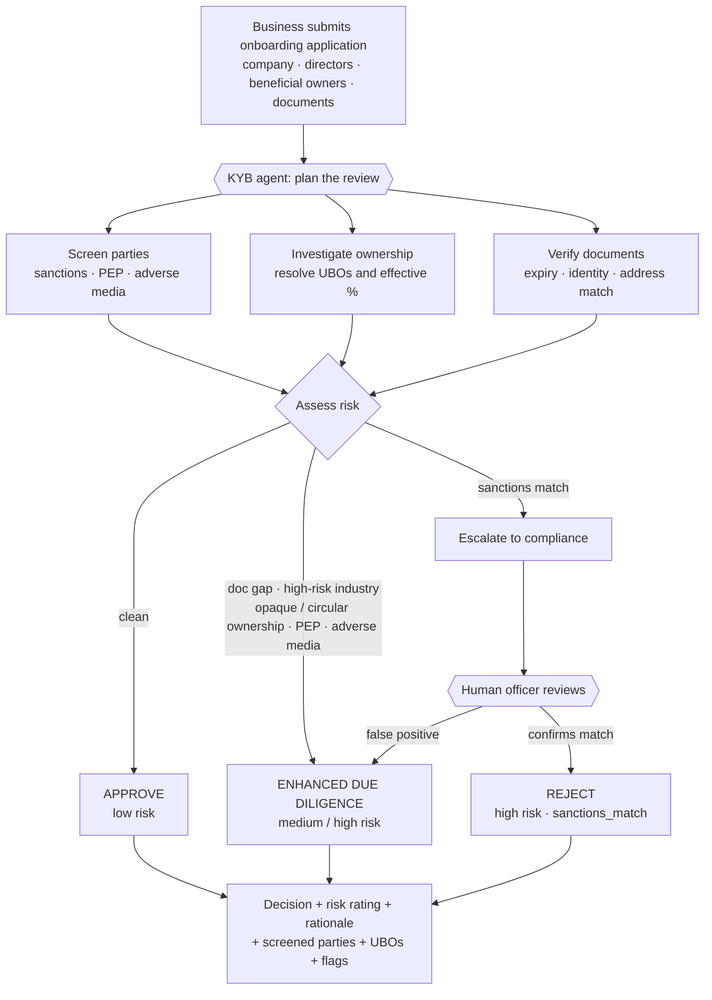

# KYB Onboarding Agent

A **Know-Your-Business (KYB) onboarding agent** that reviews business applications —
screening parties against sanctions/PEP/adverse-media lists, resolving beneficial
ownership, verifying documents — and returns an **approve / enhanced-due-diligence /
reject** decision with a risk rating and a grounded rationale. Sanctions hits pause for
human compliance approval.

It is built as a **Managed Deep Agent on LangSmith** (Cloud, every model call through the
LLM Gateway) and serves as a working demo of the **LangSmith platform across the Agent
Development Lifecycle**: Build → Test → Deploy → Monitor → Improve, with Govern throughout.

> Everything here runs on **synthetic data**, and the agent ships with a set of
> **intentional defects** (see [`PLAN.md`](demo-runbook/PLAN.md) §4.3) that surface in production
> monitoring — they are the material for the Improve/Engine stage and must not be "fixed".

## Business process



The three review steps run as **subagents** (`screening-analyst`, `ownership-investigator`,
`document-checker`); the sanctions escalation is a **human-in-the-loop interrupt** that a
compliance officer resumes.

## Repository layout

| Path | What it is |
|------|------------|
| [`agent/`](agent/) | The deployed Managed Deep Agent — main agent, subagents, tools, skills, decision policy. **Start here for implementation details** → [`agent/README.md`](agent/README.md) |
| [`simulator/`](simulator/) | Synthetic-world generator (`generate_world.py`), production traffic simulator (`send_traffic.py`), and compliance reviewer bot (`reviewer_bot.py`) |
| [`evals/`](evals/) | Offline experiments (datasets, evaluators, model-profile comparison) and online-evaluator reference implementations |
| [`demo-runbook/`](demo-runbook/) | [`SETUP.md`](demo-runbook/SETUP.md) — **build this from scratch** on your own LangSmith workspace, step by step; [`PLAN.md`](demo-runbook/PLAN.md) — the full ADLC demo plan, design decisions, planted-defect catalog, and progress log; [`DEMO.md`](demo-runbook/DEMO.md) — the ~25-min demo runbook with per-stage links and a before-state snapshot; [`GLOSSARY.md`](demo-runbook/GLOSSARY.md) — the KYB/compliance terms (EDD, PEP, UBO, sanctions, …) tied to the agent's flags and tools |

## Quick start

```bash
# run the agent locally in LangSmith Studio
cd agent && uv run mda dev

# offline experiment over the golden dataset
cd agent && uv run python ../evals/run_experiment.py --profiles opus --split sample

# drip synthetic production traffic to the deployment (cost-bounded)
cd agent && uv run python ../simulator/send_traffic.py --budget-usd 40 --shuffle --rate-seconds 90
```

To stand the whole thing up yourself on a fresh LangSmith workspace, follow
[`demo-runbook/SETUP.md`](demo-runbook/SETUP.md). See [`agent/README.md`](agent/README.md)
for architecture, model profiles, tools, and the decision policy, and
[`PLAN.md`](demo-runbook/PLAN.md) for the end-to-end demo storyline.
