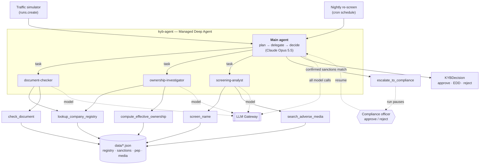
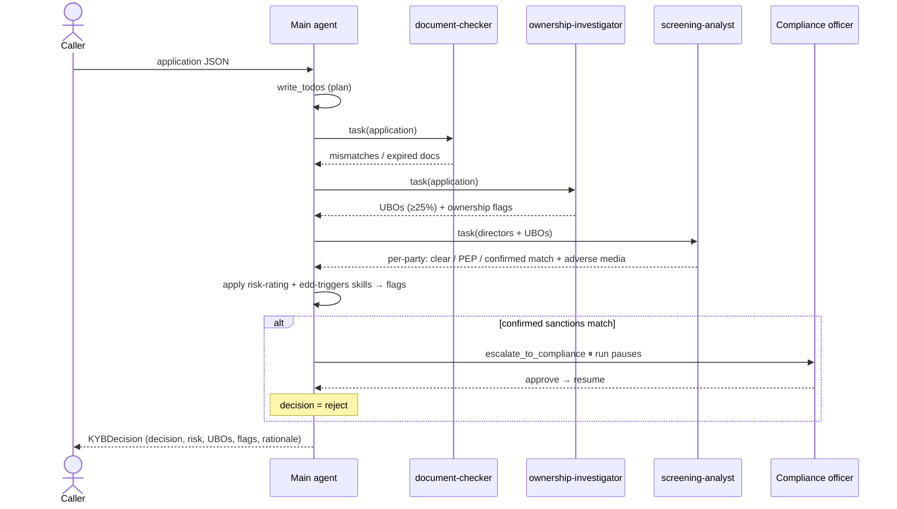

# kyb-agent

A **Know-Your-Business (KYB) onboarding agent** for a fictional payments company,
built as a [Managed Deep Agent](https://github.com/langchain-ai/managed-deepagents-sdk)
and deployed on LangSmith Cloud. Every model call is routed through the **LLM Gateway**.

When a business applies for an account, the agent:

1. **checks the application against the corporate registry** (name, number, address, directors),
2. **works out who ultimately owns the company** through nested shareholders,
3. **screens every director and owner** against sanctions, PEP lists and adverse media,
4. returns a **structured decision** — `approve`, `enhanced_due_diligence`, or `reject` —
   with a risk rating and a rationale that cites its evidence.

A confirmed sanctions match **pauses the run for a human compliance officer** before it finishes.

> This README focuses on the agents and how they work. For the broader
> build → test → deploy → monitor → improve story, see [`../PLAN.md`](../PLAN.md).

---

## Architecture

A single **main agent** plans the review and delegates to **three specialist subagents**.
Each subagent owns a couple of read-only tools over bundled synthetic data. The main
agent keeps the decision; the subagents only gather and judge evidence.



**Why subagents?** Each one runs in its own context with only the tools it needs, so the
main agent's context stays small and each specialist can be reasoned about (and evaluated)
on its own. Subagents leave `model` unset, so they inherit the main agent's Gateway model.

---

## The main agent

Defined in [`agent.py`](agent.py). Its always-on behavior lives in
[`instructions.md`](instructions.md) (synced to Context Hub at deploy).

| Aspect | Value |
|---|---|
| Model | `langsmith:anthropic/claude-opus-5-5` (via LLM Gateway) |
| Subagents | `document-checker`, `ownership-investigator`, `screening-analyst` |
| Own tools | `escalate_to_compliance`, `list_customers_for_rescreen` |
| Human-in-the-loop | `interrupt_on={"escalate_to_compliance": {"allowed_decisions": ["approve", "reject"]}}` |
| Output | `response_format=ProviderStrategy(KYBDecision)` (native structured output) |

Its loop each run:

1. **Plan** with `write_todos`.
2. **Delegate** to the three subagents (ownership before screening, since the parties to
   screen = directors **+** the computed beneficial owners).
3. **Apply the policy** from the `risk-rating` and `edd-triggers` skills to turn findings
   into flags → a decision + risk rating.
4. **Escalate** a confirmed sanctions match via `escalate_to_compliance` (which pauses the run).
5. **Return** a `KYBDecision`.

> **Why `ProviderStrategy`?** Opus/Sonnet 5.5 reject the forced `tool_choice` that the
> default structured-output strategy uses through the Gateway. `ProviderStrategy` uses the
> provider's native structured output instead. (The schema models set `extra="forbid"` so
> the Gateway's strict JSON-schema requirement — `additionalProperties: false` — is met.)

---

## The subagents

Defined in [`subagents.py`](subagents.py).

| Subagent | Tools | Job | Returns |
|---|---|---|---|
| **document-checker** | `lookup_company_registry`, `check_document` | Compare the application to the registry record (name, number, address, directors); check document expiry. | Mismatches; expired / unverifiable documents |
| **ownership-investigator** | `lookup_company_registry`, `compute_effective_ownership` | Walk nested corporate shareholders; find every person ≥ 25% effective ownership; flag opaque/circular structures and secrecy-jurisdiction holdings. | UBO list with percentages; ownership flags |
| **screening-analyst** | `screen_name`, `search_adverse_media` | Screen every director and owner against sanctions, PEP and adverse media; rule out same-name false positives using DOB/nationality. | Per party: clear / PEP / confirmed sanctions match + adverse media |

---

## The tools

Plain, **read-only** Python functions over bundled JSON in [`data/`](data) — no external
services, so runs are deterministic and safe to replay.

| Tool | Module | Used by | What it does |
|---|---|---|---|
| `lookup_company_registry` | `tools/registry.py` | document-checker, ownership-investigator | Fetch a company's registry record. |
| `compute_effective_ownership` | `tools/registry.py` | ownership-investigator | Walk the ownership tree; return UBOs (≥ 25%) and ownership flags. |
| `screen_name` | `tools/screening.py` | screening-analyst | Match a person against the sanctions + PEP watchlists. |
| `search_adverse_media` | `tools/screening.py` | screening-analyst | Find news articles mentioning a company or person. |
| `check_document` | `tools/documents.py` | document-checker | Parse a document's expiry and report valid / expired / unverifiable. |
| `escalate_to_compliance` | `tools/compliance.py` | main agent | Record a confirmed sanctions match — **gated by human approval**. |
| `list_customers_for_rescreen` | `tools/customers.py` | main agent (nightly job) | List existing customers + their people for re-screening. |

---

## How one application flows



### Human-in-the-loop (sanctions escalation)

`escalate_to_compliance` is declared in `interrupt_on`, so the run **pauses** before the
tool executes and surfaces an approval request. Resume it through the Agent Server / SDK:

```python
# When a run is interrupted, approve the escalation to let it finish:
client.runs.wait(
    thread_id, "kyb-agent",
    command={"resume": {"decisions": [{"type": "approve"}]}},
)
```

- **Live demo:** approve/reject by hand in LangSmith Studio.
- **Bulk traffic:** `../simulator/reviewer_bot.py` plays the compliance officer.
- **Offline evals:** the eval target auto-approves and records that an escalation happened.

---

## Decision policy

The agent reads two skills ([`skills/`](skills)) — synced to Context Hub, so a compliance
lead can change a threshold in the UI without a code redeploy.

**Flags** (`edd-triggers`): `sanctions_match`, `pep`, `adverse_media`, `document_mismatch`,
`expired_document`, `opaque_ownership`, `high_risk_jurisdiction`, `high_risk_industry`,
`embedded_instructions`.

**Mapping** (`risk-rating`, first match wins):

| Condition | Decision | Risk |
|---|---|---|
| Confirmed `sanctions_match` | `reject` (+ escalate) | high |
| No flags | `approve` | low |
| Any EDD flag, and (`pep` / `adverse_media` / `opaque_ownership`) **or** ≥ 2 EDD flags | `enhanced_due_diligence` | high |
| Any other single EDD flag | `enhanced_due_diligence` | medium |

A natural person is a UBO at **≥ 25%** effective ownership.

---

## Output contract

[`schemas.py`](schemas.py) — the agent's final turn returns a `KYBDecision`; evaluators read
these fields directly.

```python
class UBO(BaseModel):
    name: str
    effective_ownership_pct: float

class KYBDecision(BaseModel):
    application_id: str
    decision: Literal["approve", "enhanced_due_diligence", "reject"]
    risk_rating: Literal["low", "medium", "high"]
    ubos: list[UBO]
    screened_parties: list[str]      # lets an evaluator check screening coverage
    flags: list[Flag]
    rationale: str                   # must cite the tool evidence behind the decision
```

---

## Context, memory & triggers

- **`instructions.md`** — role, workflow and rules (always loaded; → Context Hub).
- **`skills/`** — `risk-rating` and `edd-triggers`, loaded on demand (→ Context Hub).
- **`memory.py`** — one deployment-shared tree at `/memories/agent/` for *procedural*
  learnings only (e.g. "jurisdiction X reports ownership as a 0–1 fraction"). Never personal data.
- **`schedules/nightly_rescreen.py`** — a managed cron that re-screens existing customers
  against the latest sanctions additions (ongoing KYC).
- **`identity.py`** — who may call the deployment (LangSmith workspace API key by default).

---

## Project layout

```text
agent/
  agent.py                      # define_deep_agent(...) — main agent wiring
  instructions.md               # always-on system prompt
  subagents.py                  # the 3 specialist subagents
  schemas.py                    # KYBDecision / UBO (structured output)
  tools/
    registry.py                 # lookup_company_registry, compute_effective_ownership
    screening.py                # screen_name, search_adverse_media
    documents.py                # check_document
    compliance.py               # escalate_to_compliance (human approval)
    customers.py                # list_customers_for_rescreen (nightly job)
    _data.py                    # cached JSON loader
  skills/
    risk-rating/SKILL.md        # decision + risk mapping
    edd-triggers/SKILL.md       # what raises each flag
  memory.py                     # agent memory (procedural learnings)
  schedules/nightly_rescreen.py # managed cron re-screen
  identity.py                   # who may call the deployment
  data/*.json                   # synthetic registry, watchlists, media, customers
```

---

## Run it

```bash
uv sync                                  # install deps
mda dev --no-browser --no-reload         # local LangGraph dev server + Studio
```

Send an application as a user message whose content is the application JSON under an
`application` key (see `../simulator/out/golden_v1.jsonl` for examples). The agent will
plan, delegate to the three subagents, and return a `KYBDecision`.

> **Gotchas:** the model needs an `ANTHROPIC_API_KEY` **LangSmith workspace secret** (the
> Gateway holds provider keys, not the project `.env`), and keep `.env` values **unquoted**.
> Don't run `mda build` while `mda dev` is live — it rewrites the watched build venv and
> crashes the dev server.

Deploy and operate with `mda deploy` / `mda logs` / `mda delete`; see `../PLAN.md` for the
staging/prod split, Gateway policies, and the full lifecycle.
